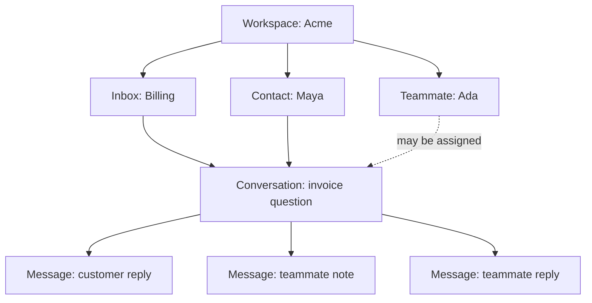
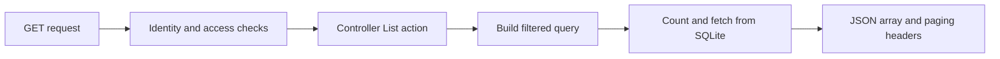
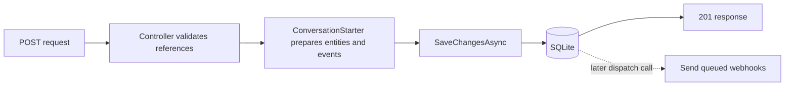

# 03: Three pictures of the same application

**Remember today:** each picture answers a different question.

## Picture A: what belongs to what?

In words: Acme has an inbox, a customer contact, and a support teammate. The
invoice conversation belongs to that inbox and contact. It contains messages.
Ada can be assigned to it. A team can also be an assignee, but the diagram leaves
that option out to keep this first picture small.

This is a simplified relationship map, not a complete database schema. Conversations
also store their workspace ID directly. The arrows do not mean the API fetched
all these records in one request.

## Picture B: how does a list reach the caller?

In words: the caller asks for conversations. Harbor checks identity and access,
chooses matching conversations, counts them, fetches one ordered page, and
returns a JSON array with metadata in headers. Binding and validation also happen
before the action handles valid input. Authentication itself can query the database;
the picture highlights the conversation-read part.

Walk the arrows while saying: **request, access, selection, fetch, response**.
Now say: **ask, check, choose, retrieve, answer**. These are two wordings for the
same broad path.

## Picture C: what happens when new work is saved?

In words: creation prepares the conversation and opening message, applies
start-time rules, and queues deliveries for applicable webhook subscriptions.
The controller saves the related database changes, then returns a creation
response. Webhook HTTP delivery happens later when dispatch is triggered.

The dashed arrow is important. Saving a pending delivery and sending HTTP to a
subscriber are different operations. There is no background dispatcher automatically
running in the current host.

## Match the picture to the question

Which picture helps you answer “Who wrote this?” Which helps with “Where does
the list come from?” Which helps with “Has the webhook already been sent?”

Check your choices

Picture A gives the relationship vocabulary. Picture B traces the read operation.
Picture C separates saving outbound work from sending it. No single diagram
answers every question, which is why the same codebase appears three times.

Next: follow [a read](04-follow-a-read.md) and [a write](05-follow-a-write.md)
more slowly, using real method names.
