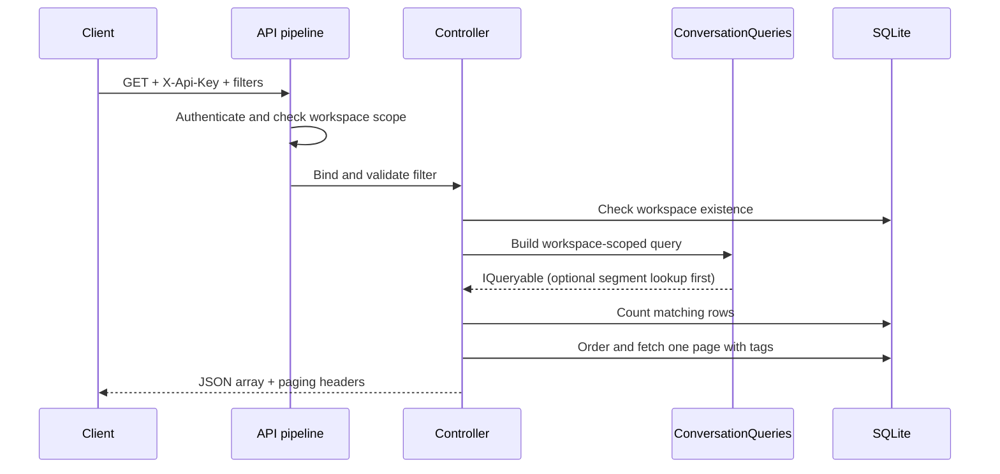

# Trace a request across boundaries

Goal: explain where a failure belongs before editing code. Use
`GET /api/workspaces/{workspaceId}/conversations?state=Open` as the running example.

This is a conceptual successful path. ASP.NET executes several framework stages;
authorization failures and binding failures can short-circuit before the action.

## 1. Transport and identity

The HTTP route identifies an operation. The API key identifies an authenticated
teammate. A GUID in the URL is not proof of permission. Read
[ApiKeyAuthenticationHandler.cs](../../src/Harbor.Api/Infrastructure/ApiKeyAuthenticationHandler.cs)
and identify where claims for teammate, role, and workspace are created.

Predict: what happens when a valid key for workspace A is sent to a route for B?
Find the answer in [WorkspaceScopeFilter](../../src/Harbor.Api/Infrastructure/WorkspaceScopeFilter.cs).
The 403 decision does not need to discover whether B exists. A by-ID endpoint
instead combines ID and the caller's workspace in its lookup, returning 404 for
a resource outside that workspace. Read [ADR 0002](../adr/0002-403-vs-404.md).

## 2. Binding and validation

The query string is converted to `ConversationFilterRequest`. Invalid dates and
unknown sort names cannot bind correctly; an undefined numeric sort is rejected
by enum validation. `IValidatableObject` checks the relationship between the two
date bounds. These produce a 400 before the controller action runs.

A missing segment is different: its ID has a valid shape, but the segment is not
available in this tenant. `BuildAsync` returns null and the controller preserves
the existing 422 ProblemDetails contract. Trace the same case through `Overview`.

Exercise: build a table with malformed GUID, invalid date, reversed date range,
missing API key, foreign workspace, and foreign segment. For each, write the
stage that rejects it and one test that would establish the behavior.

## 3. Application coordination

The controller chooses how to use a query. `List` adds ordering, tags, and paging.
`Overview` adds a SQL aggregate. The shared component defines membership: which
conversations belong in the result. Keeping membership in one place prevents two
endpoints from accidentally interpreting a filter differently.

This component lives in the API project because its input is an API contract.
`SegmentQueries` lives in Infrastructure because it works with persisted segment
rules and database queries without HTTP types. Follow dependencies rather than
assuming every class named “service” belongs in the same layer.

## 4. Persistence and response

EF translates supported expressions into SQLite operations. The list first
counts matches, then fetches a page. Those are separate statements, so a writer
between them can change the dataset. The response is useful for an interactive
queue; it is not an immutable export snapshot.

The overview performs its five counts in one aggregate statement after the
workspace/optional segment lookups. It returns a single object, including zeros
for an empty result. It does not need message bodies or tag objects in memory.

## Practice: teach a second path

Trace `POST /api/conversations/{id}/messages` yourself. Find author validation,
`RegisterMessage`, SLA breach detection, outbox publication, and `SaveChangesAsync`.
Draw where a domain rule can fail and which writes must commit together.

Exit criteria: explain why moving an HTTP result into the domain would couple
business behavior to transport, and why a database lookup cannot be replaced by
`[Required]`. Next: [data and queries](data-and-queries.md).
